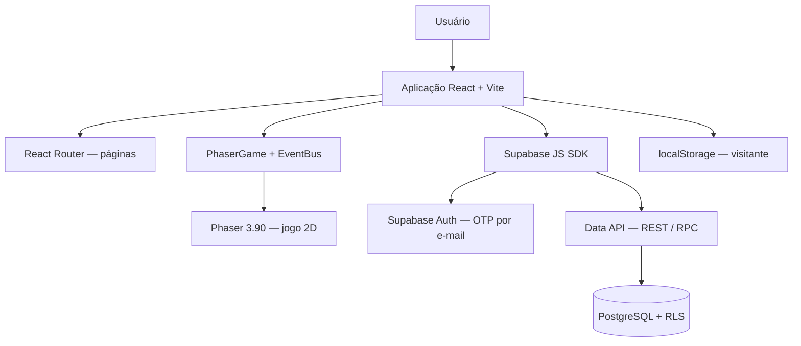

# Kitchen Dash — Arquitetura de Alto Nível

**Versão:** 1.1  
**Status:** Decisões revisadas e consolidadas

## 1. Visão geral

Kitchen Dash será uma aplicação web com um jogo 2D de cozinha em visão top-down. Qualquer pessoa poderá iniciar uma partida sem criar uma conta. A autenticação será necessária para utilizar funcionalidades associadas ao perfil, como sincronização de dados e participação no ranking.

A arquitetura será dividida em três partes:
- **Frontend:** interface da aplicação e experiência de jogo.
- **Engine de jogo:** execução e renderização da partida.
- **Backend gerenciado:** autenticação, persistência remota e dados compartilhados, utilizando Supabase.

## 2. Stack tecnológica

| Camada | Tecnologia | Responsabilidade |
|---|---|---|
| Aplicação frontend | React + JavaScript + Vite | Estrutura da aplicação, telas e componentes de interface |
| Engine de jogo | Phaser 3.90 | Renderização 2D, movimentação, colisões, animações, estações e lógica da partida |
| Estilização | Tailwind CSS v4 + daisyUI 5 | Estilos utilitários e componentes baseados apenas em classes CSS (sem TypeScript) |
| Ícones | `lucide-react` | Ícones da interface |
| Rotas | React Router (modo declarativo) | Navegação entre as páginas da aplicação |
| Integração Supabase | `@supabase/supabase-js` | Autenticação e acesso aos dados (único cliente HTTP do projeto) |
| Autenticação | Supabase Auth | Login por código temporário de 6 dígitos enviado ao e-mail (OTP) |
| Banco de dados | PostgreSQL via Supabase | Armazenamento remoto de dados associados às contas |
| API | Supabase Data API (REST + RPC) | Leitura de dados e gravação validada por funções Postgres |
| Hospedagem frontend | Cloudflare Pages (plano gratuito) | Publicação da aplicação web |
| Dados remotos no React | TanStack Query | Cache, retry e estados de carregamento |
| Monitoramento | Sentry (plano gratuito) | Erros de React e Phaser em produção |
| Anti-bot | Cloudflare Turnstile | CAPTCHA no login OTP |
| Offline / i18n | `vite-plugin-pwa`, `i18next` | Jogo offline e textos traduzíveis (pt-BR) |

Detalhamento técnico (qualidade, dados, segurança, custos): [SYSTEM_DESIGN.md](SYSTEM_DESIGN.md). Histórico de estudos e comparações: [ESTUDOS_E_DECISOES.md](ESTUDOS_E_DECISOES.md).

### 2.1 Tecnologias descartadas

- **Axios:** removido. O `supabase-js` já cobre autenticação e dados; não há API externa prevista. Se surgir uma, usar `fetch` nativo.
- **shadcn/ui:** substituído por daisyUI, já que o shadcn é voltado a TypeScript.
- **GitHub Pages:** substituído pela Cloudflare Pages, que suporta SPA sem truques de 404 e permite uso comercial no plano gratuito (o plano Hobby da Vercel não permite).

## 3. Responsabilidades dos componentes

### 3.1 React

- Página inicial e apresentação do jogo.
- Navegação entre as áreas da aplicação.
- Telas e componentes de autenticação.
- Menus, configurações, cosméticos e interfaces externas ao jogo.
- Exibição de pontuação, perfil e ranking.

### 3.2 Phaser

- Renderização do cenário 2D em visão top-down.
- Movimentação do personagem.
- Interação com ingredientes e estações de preparo.
- Colisões, animações e elementos do ambiente.
- Ciclo de jogo, pedidos, temporizadores e pontuação.

A integração seguirá o template oficial React + Vite do Phaser (`npm create @phaserjs/game`): um componente `PhaserGame` inicializa e destrói o canvas, e um `EventBus` (`Phaser.Events.EventEmitter` compartilhado) faz a comunicação entre React e as cenas (ex.: fim de partida → React exibe resultado e envia a pontuação). O React não atualiza elementos visuais da partida.

### 3.3 Supabase

Usado como Backend as a Service, sem servidor próprio:
- Autenticação por OTP de e-mail.
- Banco PostgreSQL com Row Level Security (RLS).
- Data API para leitura e funções RPC para gravações que exigem validação.

## 4. Experiência de acesso

### 4.1 Modo visitante

- Acessa a página inicial e joga sem autenticação.
- Dados mantidos localmente no dispositivo (`localStorage`).

### 4.2 Modo autenticado

- Login com `signInWithOtp({ email })` e validação com `verifyOtp({ email, token, type: 'email' })`.
- O template "Magic Link" do Supabase deve ser alterado para conter `{{ .Token }}`, enviando um código em vez de link.
- **E-mail:** SMTP padrão do Supabase durante o desenvolvimento (limite baixo de envios por hora); migrar para Resend (SMTP próprio) antes da abertura ao público.
- Funcionalidades: sincronização entre dispositivos, registro remoto de pontuações, ranking e cosméticos vinculados ao perfil.

A autenticação nunca é barreira para iniciar uma partida.

## 5. Estratégia de persistência

| Contexto | Armazenamento | Uso |
|---|---|---|
| Visitante | `localStorage` | Preferências, cosméticos desbloqueados e recordes locais |
| Usuário autenticado | Supabase / PostgreSQL | Perfil, cosméticos, pontuações e ranking |

### 5.1 Migração no login

Ao autenticar, **todos os dados locais são migrados** para a conta:
- Preferências e cosméticos são associados ao perfil.
- Recordes locais são enviados pela mesma RPC de validação das partidas normais (o `localStorage` é editável pelo usuário) e marcados com `origem = 'local'`.
- Após migração bem-sucedida, o armazenamento local passa a refletir a conta.

## 6. Ranking e anti-trapaça

- **Leitura:** pública (`anon` e `authenticated`) via RLS.
- **Escrita:** nenhuma policy de `insert`/`update` direta na tabela de pontuações. A gravação ocorre apenas pela função RPC `submit_score` (`security definer`), que:
  - usa `auth.uid()` como dono do registro;
  - valida limites de plausibilidade (pontuação máxima por segundo de partida, duração mínima e máxima);
  - limita a frequência de envios por usuário.
- Limitação conhecida: sem reexecução da partida no servidor, trapaças sofisticadas continuam possíveis (ver ROADMAP).

## 7. Comunicação entre componentes

## 8. Hospedagem e publicação

- Frontend publicado na **Cloudflare Pages** (plano gratuito), com deploy automático a partir do repositório GitHub.
- Build: `npm run build`, diretório de saída `dist`. `base` do Vite permanece `'/'`.
- Sem `404.html` na saída, a Cloudflare Pages trata o projeto como SPA, servindo `index.html` em qualquer rota (compatível com `BrowserRouter`).
- Previews automáticos por branch/PR.
- Variáveis `VITE_SUPABASE_URL` e `VITE_SUPABASE_PUBLISHABLE_KEY` configuradas no painel (apenas chave publicável no frontend).

## 9. Escopo do MVP

- [x] Partida jogável sem login.
- [x] Login por OTP de e-mail.
- [x] Ranking global com validação por RPC.
- [x] Cosméticos desbloqueados jogando (sem pagamento).

Itens futuros estão em [ROADMAP.md](ROADMAP.md).

## 10. Decisões registradas e pontos em aberto

### 10.1 Decisões definidas

- [x] React + JavaScript + Vite.
- [x] Phaser 3.90 com template oficial React.
- [x] Tailwind CSS v4 + daisyUI 5, `lucide-react` e React Router.
- [x] Axios removido; `supabase-js` como único cliente.
- [x] Supabase BaaS (Auth, PostgreSQL, Data API, RPC).
- [x] OTP de 6 dígitos por e-mail; SMTP padrão agora, Resend antes do lançamento.
- [x] Hospedagem na Cloudflare Pages (plano gratuito).
- [x] Partidas sem login; ranking exige autenticação.
- [x] Ranking gravado apenas via RPC com validação.
- [x] Migração completa dos dados locais no login, com recordes revalidados.
- [x] Nome do produto: **Kitchen Dash** (sem "Ratatouille", por ser marca registrada).

### 10.2 Pontos que ainda precisam ser detalhados

- [ ] Modelar tabelas (`profiles`, `scores`, `cosmetics`, `user_cosmetics`).
- [ ] Escrever policies RLS e a função `submit_score`.
- [ ] Definir regras de pontuação e os limites numéricos de validação.
- [ ] Definir a estrutura de rotas.
- [ ] Definir o formato dos dados locais e da migração.

## 11. Referências oficiais

- [React](https://react.dev/)
- [Vite](https://vite.dev/guide/)
- [Phaser 3 Documentation](https://docs.phaser.io/)
- [Phaser — template React](https://github.com/phaserjs/template-react)
- [Supabase Auth — Passwordless Email Logins](https://supabase.com/docs/guides/auth/auth-email-passwordless)
- [Supabase — Row Level Security](https://supabase.com/docs/guides/database/postgres/row-level-security)
- [Supabase — Database Functions](https://supabase.com/docs/guides/database/functions)
- [Supabase — Custom SMTP](https://supabase.com/docs/guides/auth/auth-smtp)
- [Cloudflare Pages — Serving Pages (SPA)](https://developers.cloudflare.com/pages/configuration/serving-pages/)
- [Tailwind CSS](https://tailwindcss.com/docs)
- [daisyUI](https://daisyui.com/)
- [Lucide React](https://lucide.dev/guide/packages/lucide-react)
- [React Router](https://reactrouter.com/)
