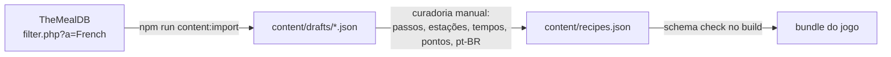
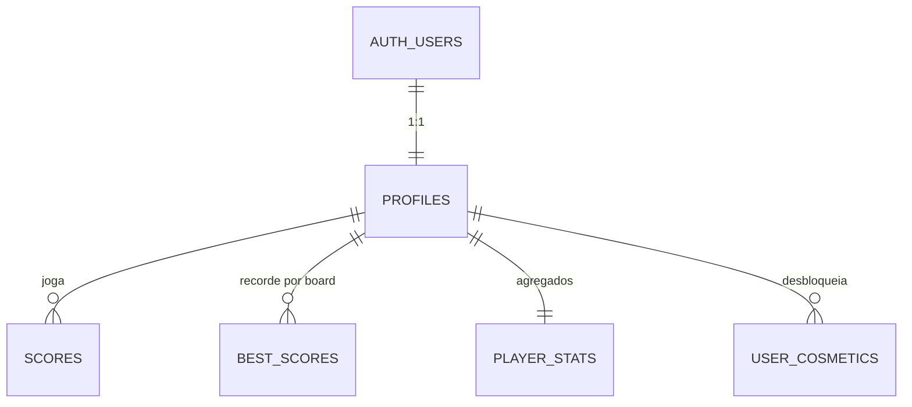
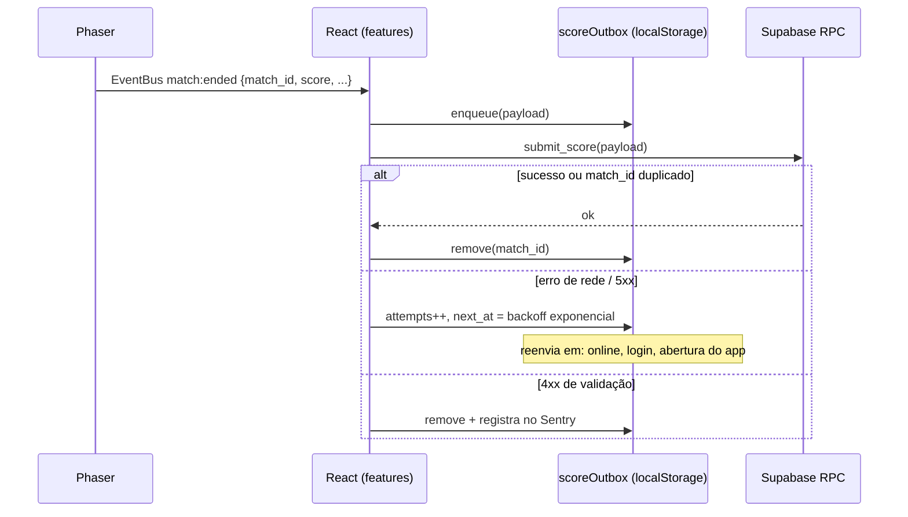
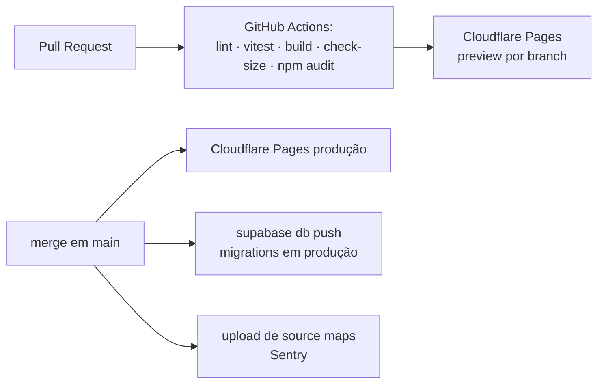

# Kitchen Dash — System Design

**Versão:** 1.0  
**Base:** [ARQUITETURA.md](ARQUITETURA.md) v1.1 · Estudos: [ESTUDOS_E_DECISOES.md](ESTUDOS_E_DECISOES.md)  
**Escopo:** decisões técnicas do MVP, desenhadas para crescer sem reescrita.

---

## 1. Princípios

1. **O jogo funciona sem rede.** A rede é necessária só para identidade, ranking e sincronização.
2. **O cliente não é confiável.** Toda gravação que afeta outros jogadores passa por validação no banco.
3. **Regras separadas de renderização.** As regras do jogo são JS puro, testável e reaproveitável no servidor.
4. **Conteúdo é dado, não código.** Receitas, cozinhas e cosméticos ficam em JSON versionado.
5. **Fornecedores atrás de interfaces.** Supabase, Sentry e analytics são acessados por módulos próprios (`services/`).
6. **Caber no plano gratuito, com caminho claro para o pago** (ver §9).

---

## 2. Registro de decisões

| # | Tema | Decisão | Alternativas descartadas |
|---|---|---|---|
| D1 | Lógica do jogo | Núcleo em JS puro (`game/core`), sem import de Phaser | Lógica dentro das cenas |
| D2 | Conteúdo | TheMealDB como **fonte de autoria no build**; mecânica curada em JSON no repo | API em tempo de execução; Spoonacular (cota compartilhada, chave exposta) |
| D3 | Estado React | TanStack Query (dados remotos) + Context (sessão) | Zustand; só Context |
| D4 | Testes | Vitest no core e serviços + ESLint/Prettier no CI | Playwright E2E (pós-MVP) |
| D5 | Falha de envio | Outbox local com retry e RPC idempotente por `match_id` | Erro manual; descarte |
| D6 | Ranking | Histórico (`scores`) + melhor por jogador (`best_scores`) | Só histórico; só melhor |
| D7 | Retenção | Histórico de 90 dias via `pg_cron`; recordes e estatísticas permanentes | Sem retenção; 30 dias |
| D8 | Plataforma | Só desktop com teclado no MVP; input abstraído | Mobile/gamepad (ROADMAP) |
| D9 | Anti-bot | Cloudflare Turnstile no login OTP | hCaptcha; só rate limit |
| D10 | Ambientes | Supabase CLI local (Docker) + 1 projeto de produção; migrations no repo | 2 projetos na nuvem; edição pelo painel |
| D11 | Erros | Sentry (plano Developer, gratuito) | Datadog RUM (pago por sessão, foco em backend) |
| D12 | Analytics | Cloudflare Web Analytics + PostHog — **ROADMAP, prioridade baixa** | Tabela de eventos no Supabase |
| D13 | Privacidade | Sem cookies de analytics até consentimento; política de privacidade e exclusão de conta no MVP | Banner bloqueante |
| D14 | RNFs do MVP | i18n preparado (pt-BR), acessibilidade básica, PWA offline, orçamento de tamanho | Orçamento de fps (ROADMAP) |

---

## 3. Estrutura do código (manutenibilidade)

```
src/
├── app/                 # rotas (React Router), providers, layout, ErrorBoundary
├── features/            # fatias verticais da aplicação
│   ├── auth/            # login OTP + Turnstile
│   ├── ranking/
│   ├── profile/         # nome, configurações, exclusão de conta
│   └── cosmetics/
├── game/
│   ├── core/            # JS puro: MatchState, OrderQueue, Recipe, Patience, Scoring, rng com seed
│   ├── phaser/          # PhaserGame.jsx, EventBus, cenas (Boot, Preload, Kitchen, HUD)
│   └── input/           # InputMap: ações abstratas (move, interact, drop) ← teclado hoje, toque depois
├── content/             # recipes.json, kitchens.json, cosmetics.json + schemas
├── services/            # supabase.js, storage.js, scoreOutbox.js, monitoring.js, analytics.js (stub)
├── i18n/                # pt-BR.json
└── ui/                  # componentes daisyUI reutilizáveis
supabase/
├── migrations/          # SQL versionado (fonte da verdade do schema)
├── seed.sql
└── tests/               # testes de RLS/RPC (pgTAP) — opcional no MVP
scripts/
├── content-import.js    # TheMealDB → rascunhos JSON
└── check-size.js        # orçamento de tamanho do build
```

**Regras de dependência**
- `game/core` não importa Phaser, React nem `services`. Recebe entradas e devolve estado e eventos.
- `game/phaser` lê o core e emite pelo `EventBus` (`match:ended`, `match:paused`...). Não chama o Supabase.
- `features/*` reagem ao `EventBus` e falam com o backend via `services/`.
- O ESLint impõe essas fronteiras com `no-restricted-imports`.

**Determinismo (preparação para crescimento):** cada partida tem `seed` e `content_version`. O mesmo seed com o mesmo conteúdo gera a mesma sequência de pedidos. Isso habilita, sem reescrita, desafios com seed compartilhada e validação por replay no servidor (ROADMAP).

---

## 4. Pipeline de conteúdo (TheMealDB)



- A importação roda **só na máquina do desenvolvedor**; a produção nunca chama a API.
- A curadoria adiciona `steps: [{ station: 'cutting', durationMs: 1500 }, ...]`, `points`, `sprite` e nomes em pt-BR.
- `content_version` (hash do JSON) vai em cada pontuação enviada.
- **Licença:** fotos do TheMealDB servem apenas de referência; sprites do jogo são próprios.

---

## 5. Modelo de dados (PostgreSQL)



| Tabela | Colunas principais | Observações |
|---|---|---|
| `profiles` | `id` (PK, FK `auth.users` on delete cascade), `display_name` (único, 3–20, regex), `settings jsonb`, `equipped jsonb`, `created_at` | Criada por trigger no cadastro |
| `scores` | `id bigint identity`, `match_id uuid UNIQUE`, `user_id`, `board text default 'global'`, `score int`, `duration_ms int`, `seed`, `content_version`, `origin ('online'\|'local')`, `created_at` | Retida por 90 dias. Índices: `(user_id, created_at desc)`, `(created_at)` |
| `best_scores` | PK `(board, user_id)`, `score`, `match_id`, `achieved_at` | Índice `(board, score desc, achieved_at)`. `board` permite rankings por desafio/cozinha no futuro |
| `player_stats` | `user_id` PK, `matches_played`, `total_score`, `orders_completed`, `play_time_ms` | Sobrevive à retenção; base para desbloqueio de cosméticos |
| `user_cosmetics` | PK `(user_id, cosmetic_id)`, `unlocked_at` | Catálogo de cosméticos vive em `content/cosmetics.json` |

Catálogos (receitas, cosméticos) **não** ficam no banco no MVP. Eles vão para o banco quando houver eventos ao vivo ou loja.

---

## 6. Segurança

### 6.1 Acesso a dados (RLS)

| Tabela | `anon` | `authenticated` |
|---|---|---|
| `profiles` | `select` (só `id`, `display_name`, `equipped` via view `public_profiles`) | `select`/`update` da própria linha |
| `scores` | — | `select` das próprias linhas |
| `best_scores` | `select` | `select` |
| `player_stats` | — | `select` da própria linha |
| `user_cosmetics` | — | `select` das próprias linhas |

**Nenhuma** policy de `insert`/`update`/`delete` direto em `scores`, `best_scores`, `player_stats` e `user_cosmetics`. Toda escrita passa por RPC.

### 6.2 RPCs (`security definer`, `set search_path = ''`, `execute` revogado de `anon`)

**`submit_score(match_id, board, score, duration_ms, seed, content_version, origin)`**
1. Rejeita se `auth.uid()` for nulo.
2. **Idempotência:** se `match_id` já existe, retorna o resultado anterior.
3. **Rate limit:** no máximo N envios por usuário em 60 s.
4. **Plausibilidade:**
   - `duration_ms` entre a duração mínima e a máxima da partida;
   - `score ≤ duration_s × MAX_PONTOS_POR_SEGUNDO` (constante derivada do conteúdo);
   - `content_version` dentro de uma lista aceita.
5. Insere em `scores`, faz upsert em `best_scores` se for maior e atualiza `player_stats`.
6. Avalia desbloqueios de cosméticos a partir de `player_stats`.

**`delete_my_account()`** remove os dados do usuário (exigência da LGPD).

As constantes de validação ficam numa tabela `game_rules` (somente leitura), para serem ajustadas sem nova migration de função.

### 6.3 Superfície do cliente
- Só a **chave publicável** do Supabase no frontend. A chave secreta nunca sai do CI.
- **Turnstile:** o token vai em `signInWithOtp({ email, options: { captchaToken } })`, com a proteção por CAPTCHA ativada no Supabase Auth.
- OTP de 6 dígitos com expiração curta e rate limit de e-mails do Supabase.
- **Cabeçalhos de segurança** via arquivo `_headers` da Cloudflare Pages: CSP restringindo `connect-src` ao Supabase, Sentry e Turnstile; `X-Frame-Options: DENY`; `Referrer-Policy`.
- **Sentry:** `sendDefaultPii: false` e remoção de e-mail dos eventos.
- `display_name`: validado por regex e tamanho no banco. Filtro de palavrões vai para o ROADMAP.
- **Dependências:** Dependabot ativo e `npm audit` no CI.

### 6.4 Privacidade (LGPD)
- Dados pessoais coletados: e-mail (Auth) e nome de exibição.
- Página de política de privacidade e opção de excluir a conta no MVP.
- Analytics (quando implementado): PostHog sem cookies (`persistence: 'memory'`) até o consentimento.

---

## 7. Confiabilidade

### 7.1 Envio de pontuação com outbox



- O visitante enfileira só localmente. No login, os itens vão com `origin = 'local'` (migração completa, D-arquitetura §5.1).
- A outbox aceita no máximo 50 itens. Acima disso, descarta os mais antigos, mantendo sempre o melhor resultado.

### 7.2 Armazenamento local versionado
- Chaves com prefixo `kd:v1:` (`settings`, `progress`, `outbox`, `cosmetics`).
- `storage.js` aplica migrations de schema local na inicialização e trata JSON corrompido sem quebrar o app.
- Todo acesso fica em `try/catch`, porque o `localStorage` pode estar bloqueado (modo privado).

### 7.3 Degradação
| Falha | Comportamento |
|---|---|
| Sem internet | O jogo roda (PWA). Ranking e login mostram estado offline. As pontuações aguardam na outbox |
| Supabase fora do ar ou pausado | Igual ao offline. Erro reportado ao Sentry |
| Erro de renderização no React | `ErrorBoundary` por rota, com botão de recarregar |
| Erro no Phaser | Captura pelo Sentry. A cena volta ao menu sem derrubar a aplicação |

### 7.4 Riscos aceitos no MVP
- **Sem backups no plano Free.** O schema é reconstruível pelas migrations. A perda seria de contas e recordes. Mitigação: migrar para o Pro antes da divulgação pública.
- **Pausa por inatividade (7 dias)** afeta só o desenvolvimento. Com jogadores ativos, o projeto não pausa.

---

## 8. Usabilidade e eficiência

### 8.1 Plataforma e input
- Desktop com teclado: WASD/setas, `E`/`Espaço` para interagir, `Esc` para pausar.
- `InputMap` traduz teclas em ações. As teclas podem ser remapeadas e ficam salvas em `settings`. O joystick virtual entra no mesmo mapa no futuro.
- Em telas de toque, a home funciona normalmente e a tela de jogo mostra um aviso.

### 8.2 Acessibilidade básica
- Menus React navegáveis por teclado, foco visível e uso semântico do daisyUI.
- Contraste mínimo WCAG AA nos temas.
- Estado dos pedidos indicado por ícone e barra, não só por cor.
- Opção "reduzir efeitos" (screen shake e flashes). O padrão segue `prefers-reduced-motion`.

### 8.3 Internacionalização
- `i18next` com um único dicionário compartilhado entre React (`react-i18next`) e as cenas do Phaser (instância usada fora do React).
- pt-BR no MVP. Nenhum texto fica escrito direto no código. O conteúdo (nomes de receitas) usa chaves de tradução.

### 8.4 PWA (jogo offline)
- `vite-plugin-pwa` (Workbox):
  - **precache:** shell da aplicação, bundle do jogo, atlas e sons;
  - **network-only:** Supabase (Auth/API), Sentry e Turnstile.
- Atualização com aviso "nova versão disponível — recarregar", nunca no meio de uma partida.
- O login exige rede. A interface deixa isso explícito.

### 8.5 Orçamento de tamanho (obrigatório no MVP)

Derivado dos limites da Cloudflare Pages Free (**20.000 arquivos por site, 25 MiB por arquivo, 500 builds por mês**) e do custo de precache do PWA:

| Métrica | Limite | Motivo |
|---|---|---|
| Arquivos em `dist/` | ≤ 500 | Folga de 40× sobre o limite; força o uso de atlas de sprites |
| Maior arquivo | ≤ 5 MiB | Folga de 5× sobre 25 MiB; áudio em `.ogg`/`.mp3` comprimido |
| `dist/` total | ≤ 25 MiB | Mantém instalação PWA e primeiro acesso razoáveis |
| Precache PWA | ≤ 15 MiB | Primeira visita viável em conexões móveis e Wi-Fi fraco |
| JS inicial (home, gzip) | ≤ 250 KB | Phaser carregado sob demanda (`lazy`) só na rota do jogo |

`scripts/check-size.js` roda no CI após o build e **falha o pipeline** se algum limite for ultrapassado. Orçamento de FPS e otimizações de runtime ficam no ROADMAP.

---

## 9. Escalabilidade e custos

Premissas e estudo completo: 10 sessões e 30 partidas por MAU autenticado por mês; ~250 B por partida e ~5 KB por usuário; visitantes não contam MAU (**não** usar *anonymous sign-in*).

| MAU autenticados | Banco (retenção 90 d) | Egress/mês | Plano | Custo estimado |
|---|---|---|---|---|
| até ~15 mil | ≤ ~440 MB | ≤ ~3,75 GB | Free | US$ 0 |
| até ~100 mil | ~2,8 GB | ~25 GB | Pro | ~US$ 25/mês |
| 200 mil | ~5,5 GB | ~50 GB | Pro + MAU extra + compute Small | ~US$ 365/mês |
| 500 mil | ~14 GB | ~125 GB | Pro + MAU extra + compute Medium | ~US$ 1.400/mês |

**Gatilhos de ação (revisados mensalmente no painel do Supabase)**

| Indicador | Gatilho | Ação |
|---|---|---|
| Tamanho do banco | > 350 MB | Planejar Pro ou reduzir retenção para 30 dias |
| Egress | > 3,5 GB/mês | Aumentar `staleTime` do ranking ou servir snapshot estático |
| MAU | > 12 mil | Migrar para Pro |
| Divulgação pública | — | Migrar para Pro (backups) e trocar o SMTP para Resend |

**Eficiência de leitura**
- Ranking paginado de 20 em 20, só as colunas necessárias, com `staleTime` de 60 s no TanStack Query.
- Assets do jogo servidos pela CDN da Cloudflare, sem custar egress do Supabase.

---

## 10. Entrega (CI/CD)



- Desenvolvimento local: `supabase start` (Docker), com Auth, banco e e-mails capturados no Mailpit/Inbucket local.
- Segredos no GitHub (`SUPABASE_ACCESS_TOKEN`, `SUPABASE_DB_PASSWORD`, `SENTRY_AUTH_TOKEN`). Variáveis públicas `VITE_*` na Cloudflare.
- O limite de 500 builds por mês comporta ~16 deploys por dia.

---

## 11. Dependências do MVP

| Pacote | Uso |
|---|---|
| `react`, `react-dom`, `react-router` | Aplicação e rotas |
| `phaser@3.90` | Engine |
| `@supabase/supabase-js` | Auth e dados |
| `@tanstack/react-query` | Cache de dados remotos |
| `tailwindcss@4`, `daisyui@5`, `lucide-react` | Interface |
| `i18next`, `react-i18next` | Internacionalização |
| `@sentry/react`, `@sentry/vite-plugin` | Monitoramento de erros |
| `@marsidev/react-turnstile` (ou script oficial) | CAPTCHA |
| `vite-plugin-pwa` | PWA |
| Dev: `vitest`, `eslint`, `prettier`, `supabase` (CLI) | Qualidade e banco local |

---

## 12. Referências

- [Supabase — Pricing](https://supabase.com/pricing) · [Billing](https://supabase.com/docs/guides/platform/billing-on-supabase) · [Database size](https://supabase.com/docs/guides/platform/database-size) · [MAU](https://supabase.com/docs/guides/platform/manage-your-usage/monthly-active-users) · [Egress](https://supabase.com/docs/guides/platform/manage-your-usage/egress.md)
- [Supabase — Auth CAPTCHA](https://supabase.com/docs/guides/auth/auth-captcha) · [RLS](https://supabase.com/docs/guides/database/postgres/row-level-security) · [pg_cron](https://supabase.com/docs/guides/database/extensions/pg_cron) · [Local development](https://supabase.com/docs/guides/local-development)
- [Cloudflare Pages — Limits](https://developers.cloudflare.com/pages/platform/limits/) · [Web Analytics](https://developers.cloudflare.com/analytics/web-analytics)
- [TheMealDB API](https://www.themealdb.com/api.php)
- [Sentry — React](https://docs.sentry.io/platforms/javascript/guides/react/) · [Sentry pricing](https://sentry.io/pricing/)
- [Datadog — Pricing](https://www.datadoghq.com/pricing/)
- [PostHog — Pricing](https://posthog.com/pricing)
- [vite-plugin-pwa](https://vite-pwa-org.netlify.app/)
- [Phaser — template React](https://github.com/phaserjs/template-react)
