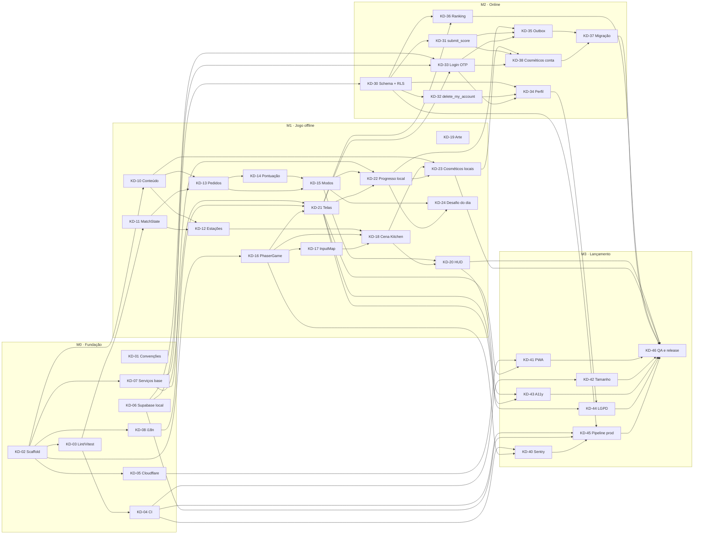

# Kitchen Dash — Plano de Entrega do MVP

**Base:** [PRD](PRD.md) · [Arquitetura](ARQUITETURA.md) §9 · [System Design](SYSTEM_DESIGN.md)  
**Acompanhamento:** GitHub Issues + GitHub Projects (decisão em [Estudos e Decisões](ESTUDOS_E_DECISOES.md) §8)  
**Visão:** alto nível. Cada task vira uma issue; o detalhamento técnico de cada uma é feito por quem a pegar (com Spec Kit, se fizer sentido).

---

## 1. O que é o MVP

Ao final, uma pessoa deve conseguir:

1. Abrir o site, escolher **1 ou 2 jogadores** e um modo (**Clássico, Livre ou Desafio**) e jogar no teclado, **sem conta e até offline**.
2. Ver recordes locais e **desbloquear cosméticos** (chapéu, avental, tema) jogando.
3. **Entrar com código por e-mail** (OTP + Turnstile) e ter o progresso local migrado para a conta.
4. Aparecer no **ranking global**, com a pontuação validada no servidor (RPC `submit_score`).
5. Editar o nome, **excluir a conta** e ler a política de privacidade.

Fora do MVP: tudo em [ROADMAP.md](ROADMAP.md) (mobile, Pix, analytics, E2E, Resend, plano Pro).

---

## 2. Marcos

| Marco | Entrega verificável | Tasks |
|---|---|---|
| **M0 · Fundação** | Repositório com app vazio rodando, CI verde, preview na Cloudflare e Supabase local de pé | KD-01 a KD-08 |
| **M1 · Jogo offline** | Partida completa nos 3 modos, 1 e 2 jogadores, com recordes e cosméticos locais | KD-10 a KD-24 |
| **M2 · Online** | Login OTP, ranking global, pontuação via RPC, migração local → conta | KD-30 a KD-38 |
| **M3 · Lançamento** | Sentry, PWA, acessibilidade, LGPD, pipeline de produção e QA final | KD-40 a KD-46 |

Os marcos não são estritamente sequenciais: o backend (M2) começa assim que o Supabase local existe, em paralelo ao jogo (M1).

---

## 3. Trilhas (como dividir o time)

| Trilha | Escopo | Perfil |
|---|---|---|
| `infra` | Scaffold, CI/CD, deploy, convenções | Quem gosta de tooling |
| `core` | Regras do jogo em JS puro (`game/core`), com testes | Lógica e testes |
| `jogo` | Phaser: cenas, input, HUD | Jogo / canvas |
| `app` | Telas React, serviços, integração com o backend | Frontend |
| `backend` | Schema, RLS, RPCs, Auth no Supabase | SQL / segurança |
| `arte` | Sprites, atlas, sons, paleta | Design |
| `qualidade` | Sentry, PWA, acessibilidade, orçamento de tamanho, QA | Transversal |

Com 4–5 pessoas, uma divisão razoável é: **core**, **jogo + arte**, **app**, **backend**, com `infra` e `qualidade` rotativas.

---

## 4. Tasks

**Legenda:** ⭐ caminho crítico · 🧩 pode começar com placeholders · *stretch* = entra se sobrar tempo.

### M0 · Fundação

| ID | Task | Trilha | Depende de |
|---|---|---|---|
| KD-01 | Convenções do time: branches, commits, PR, Definition of Done, constituição do projeto | infra | — |
| KD-02 ⭐ | Scaffold: template oficial Phaser React + Vite (JS), Tailwind v4 + daisyUI 5, React Router, Lucide e estrutura de pastas do System Design §3 | infra | — |
| KD-03 ⭐ | Qualidade local: ESLint (com fronteiras `no-restricted-imports`), Prettier e Vitest | infra | KD-02 |
| KD-04 | CI no GitHub Actions (lint, testes, build, `npm audit`) + Dependabot | infra | KD-03 |
| KD-05 | Deploy na Cloudflare Pages: produção, previews por PR e `_headers` (CSP etc.) | infra | KD-02 |
| KD-06 ⭐ | Supabase: CLI local (Docker), pasta `supabase/` com migrations e seed, projeto de produção criado | backend | — |
| KD-07 | Serviços base: `storage.js` (prefixo `kd:v1:`, migrations locais, `try/catch`) e cliente `supabase.js` com variáveis `VITE_*` | app | KD-02 |
| KD-08 | i18n: `i18next` com dicionário pt-BR único para React e Phaser | app | KD-02 |

### M1 · Jogo offline

| ID | Task | Trilha | Depende de |
|---|---|---|---|
| KD-10 | Conteúdo: `recipes.json`, `kitchens.json`, `cosmetics.json` com schemas, validação no build e `content_version` | core | KD-02 |
| KD-11 ⭐ | Core: RNG com seed, `MatchState`, relógio e ciclo de atualização | core | KD-03 |
| KD-12 | Core: estações e ingredientes (caixas, tábua, fogão com queima, balcão, pratos, lixeira, passe) | core | KD-10, KD-11 |
| KD-13 ⭐ | Core: pedidos e paciência (`OrderQueue`, desbloqueio de receitas por tempo, fila) | core | KD-10, KD-11 |
| KD-14 ⭐ | Core: pontuação (base, gorjeta, combo, penalidades, piso zero) | core | KD-13 |
| KD-15 ⭐ | Core: modos Clássico (3 min), Livre (sem tempo) e Desafio (12 pedidos fixos) | core | KD-13, KD-14 |
| KD-16 | Phaser: `PhaserGame` + `EventBus`, cenas Boot/Preload e carregamento *lazy* na rota do jogo | jogo | KD-02 |
| KD-17 | `InputMap`: P1 (setas + Enter), P2 (WASD + Espaço), pausa; toque rápido / segurar / parado; teclas remapeáveis | jogo | KD-16 |
| KD-18 ⭐ 🧩 | Cena Kitchen: mapa, colisões, chefs P1/P2, estação alvo destacada e checagem de alcançabilidade | jogo | KD-12, KD-16, KD-17 |
| KD-19 🧩 | Arte e áudio próprios: sprites, atlas, sons e paleta bistrô | arte | — |
| KD-20 ⭐ | HUD: comandas com paciência (ícone + barra), placar, cronômetro e pausa | jogo | KD-15, KD-18 |
| KD-21 | Telas React: home, escolha de modo e jogadores, pausa, resultado (via `match:ended`) | app | KD-07, KD-08, KD-16 |
| KD-22 | Progresso local do visitante: recordes, placar dos chefs, melhor tempo do Desafio, configurações | app | KD-07, KD-15, KD-21 |
| KD-23 | Cosméticos locais: desbloqueio por recorde, tela de personalização, aplicar no jogo | app | KD-10, KD-18, KD-22 |
| KD-24 | *Stretch:* Desafio do dia (escolhido pela data) | core | KD-15, KD-22 |

### M2 · Online

| ID | Task | Trilha | Depende de |
|---|---|---|---|
| KD-30 ⭐ | Schema + RLS: `profiles` (trigger), `scores`, `best_scores`, `player_stats`, `user_cosmetics`, `game_rules`, view `public_profiles` | backend | KD-06 |
| KD-31 ⭐ | RPC `submit_score`: idempotência, rate limit, plausibilidade, `best_scores`, `player_stats`, desbloqueios; testes | backend | KD-30 |
| KD-32 | RPC `delete_my_account` + retenção de 90 dias com `pg_cron` | backend | KD-30 |
| KD-33 ⭐ | Login OTP: template de e-mail com `{{ .Token }}`, Turnstile, telas e contexto de sessão | app | KD-06, KD-07, KD-21 |
| KD-34 | Perfil: nome de exibição, sincronização de configurações, botão de excluir conta | app | KD-30, KD-32, KD-33 |
| KD-35 ⭐ | Envio de pontuação: `scoreOutbox` com backoff, ligado ao fim de partida | app | KD-22, KD-31, KD-33 |
| KD-36 | Ranking: página paginada (20), TanStack Query, estado offline | app | KD-21, KD-30 |
| KD-37 ⭐ | Migração local → conta no login (recordes revalidados com `origin = 'local'`, cosméticos, configurações) | app | KD-35, KD-38 |
| KD-38 | Cosméticos na conta: `user_cosmetics`, itens equipados no perfil | app | KD-23, KD-31, KD-33 |

> KD-31 usa a constante `MAX_PONTOS_POR_SEGUNDO`, que sai das regras de KD-14. A RPC pode ser escrita antes com um valor provisório em `game_rules`; o valor final é ajustado quando KD-14 fechar.

### M3 · Lançamento

| ID | Task | Trilha | Depende de |
|---|---|---|---|
| KD-40 | Sentry: React + Phaser, `ErrorBoundary` por rota, remoção de PII, source maps no CI | qualidade | KD-04, KD-16 |
| KD-41 | PWA offline: precache do jogo, network-only para Supabase/Sentry/Turnstile, aviso de atualização | qualidade | KD-05, KD-21 |
| KD-42 | Orçamento de tamanho: `scripts/check-size.js` falhando o CI | qualidade | KD-04 |
| KD-43 | Acessibilidade básica: foco visível, contraste AA, "reduzir efeitos", aviso em telas de toque | qualidade | KD-20, KD-21 |
| KD-44 | Privacidade (LGPD): página de política e acesso à exclusão de conta | app | KD-21, KD-34 |
| KD-45 | Pipeline de produção: `supabase db push` no merge, segredos do GitHub, release no Sentry | infra | KD-04, KD-06, KD-30, KD-40 |
| KD-46 ⭐ | QA e release: 2 jogadores em todos os modos, telas pequenas, checklist de lançamento | qualidade | KD-20, KD-23, KD-36, KD-37, KD-41, KD-42, KD-43, KD-44, KD-45 |

---

## 5. Dependências

---

## 6. Ordem e paralelização (ondas)

Uma task entra numa onda quando todas as suas dependências estão em ondas anteriores. **Tudo dentro de uma mesma onda pode ser feito em paralelo.**

| Onda | Tasks em paralelo | Observação |
|---|---|---|
| 0 | KD-01, **KD-02**, **KD-06**, KD-19 | Começo do projeto: 4 frentes independentes |
| 1 | **KD-03**, KD-05, KD-07, KD-08, KD-10, KD-16, **KD-30** | O scaffold destrava quase tudo; o backend já anda sozinho |
| 2 | KD-04, **KD-11**, KD-17, KD-21, **KD-31**, KD-32 | Core, Phaser, telas e RPCs em paralelo |
| 3 | KD-12, **KD-13**, **KD-33**, KD-36, KD-40, KD-41, KD-42 | Maior largura: até 7 tasks simultâneas |
| 4 | **KD-14**, KD-18, KD-34, KD-45 | |
| 5 | **KD-15**, KD-44 | Gargalo: os modos dependem de pedidos + pontuação |
| 6 | **KD-20**, KD-22 | Fim de M1 à vista |
| 7 | KD-23, KD-24, **KD-35**, KD-43 | |
| 8 | KD-38 | |
| 9 | **KD-37** | |
| 10 | **KD-46** | QA e release |

### Caminho crítico

`KD-02 → KD-03 → KD-11 → KD-13 → KD-14 → KD-15 → KD-22 → KD-23 → KD-38 → KD-37 → KD-46`

Qualquer atraso nessa cadeia atrasa o MVP. Recomendações:

- **Priorize o core** (KD-11 → KD-15): é JS puro e testável, então dá para avançar sem Phaser nem arte.
- **Não espere a arte:** KD-18 e KD-20 começam com retângulos e emojis; KD-19 substitui depois.
- **Não espere o core para o backend:** KD-30/31 andam desde a onda 1, com constantes provisórias.
- **Combine contratos cedo:** o payload de `match:ended` (KD-16/KD-21) e a assinatura de `submit_score` (KD-31) devem ser definidos na primeira semana para que app, jogo e backend trabalhem sem bloqueio.

---

## 7. Como pegar uma task

1. No board do GitHub Projects, escolha uma issue em **Todo** sem bloqueios abertos (campo *Blocked by* vazio ou todos fechados).
2. Atribua a si mesmo e mova para **In Progress**.
3. Crie a branch a partir de `main` (`feat/kd-13-pedidos`, por exemplo).
4. Se a task for grande, detalhe com o Spec Kit (`/speckit-specify` → `/speckit-plan` → `/speckit-tasks`).
5. Abra o PR com `Closes #<número>`; a issue fecha no merge e o board se atualiza.
